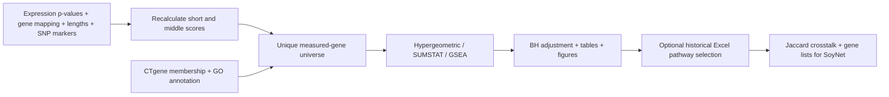

# Soybean cold tolerance pathways

Recalculate gene scores and test short- and mid-term soybean cold-tolerance pathways with **Python or R**. Each language runs independently and implements hypergeometric testing, SUMSTAT, and positive-tail weighted GSEA. MaxMean is optional and experimental.

Research companion to [Liu et al. (2025), *A multi-layered systems biology framework reveals dual-phased regulators and hormonal crosstalk underlying soybean cold tolerance*](https://doi.org/10.1007/s00299-025-03643-2).

**Research status:** this is a documented reanalysis, not a verified reproduction of every published pathway result. Matching the archived gene scores requires explicitly unconfirmed reconstruction hypotheses. The full workflow uses the historical expression-p-value branch; its relationship to the paper's fold-change description remains unresolved. Read [reproducibility status](docs/REPRODUCIBILITY.md) before interpreting results.

## Start here

Download and extract the repository ZIP, or clone it:

```sh
git clone https://github.com/benbenbeatit912002/soybean-cold-tolerance-pathways.git
cd soybean-cold-tolerance-pathways
```

Open a terminal in the extracted/cloned folder. **All inputs for the workflow below are included.** No original D: drive, Excel installation, saved interactive session, or online data service is needed. Choose one language:

| Language | Tested environment | Instructions |
|---|---|---|
| Python | Python 3.11; pinned NumPy, SciPy, Matplotlib | [Python guide](docs/RUN_PYTHON.md) |
| R | R 4.5.1; base R only | [R guide](docs/RUN_R.md) |

### Python quick start

```sh
python -m pip install -r requirements.txt
python run_pipeline.py --mode demo
```

### R quick start

```sh
Rscript --vanilla run_pipeline.R --mode demo
```

The demo uses **invented data**, runs both phases, and writes six method tables and six figures under `results/python_demo/analysis/` or `results/r_demo/analysis/`, plus input checks and execution settings. Its numbers are not soybean research results.

## Run the soybean analysis

Choose either command. The explicit flag enables the [documented score-reconstruction hypotheses](docs/REPRODUCIBILITY.md#score-reconstruction).

```sh
python run_pipeline.py --mode full --use-reconstruction-hypotheses
```

```sh
Rscript --vanilla run_pipeline.R --mode full --use-reconstruction-hypotheses
```

Each command rebuilds both phases' scores from packaged upstream files, runs the analysis, and plots the results. Saved reference scores are used only in separate validation, never as calculation inputs.

| Mode | Data | Random sets per distinct pathway size and method | Purpose |
|---|---|---:|---|
| `demo` | 20 invented genes, three pathways | 199 | Learn the interface and check installation |
| `quick` | Complete packaged soybean inputs | 199 | Check execution; not final significance estimates |
| `full` | Complete packaged soybean inputs | 10,000 | Complete reanalysis |

Replace `full` with `quick` for a shorter real-data execution check. Add `--include-maxmean` to include experimental MaxMean. Hypergeometric probabilities are exact and need no simulations. Full runs can take tens of minutes depending on hardware; each method prints progress.

Outputs go to a language/mode-specific directory, such as `results/python_full/`. Existing nonempty output directories are refused to prevent stale results. For another run, add `--output results/my_second_run`. Run `--help` for options.

Without the hypotheses flag, a real-data run saves the unresolved score audit and exits with status 2 before pathway analysis. It does not silently fill or copy the remaining scores.

## What the workflow does



The main analysis uses 42,575 mapped records representing **42,567 unique genes**, averages duplicate-gene scores, and tests 2,689 GO terms with 6-1,500 measured genes. The CT lists contain 44 short-term and 143 mid-term genes; 41 and 143 occur in this measured universe. Long-term analyses are outside scope.

Python and R implement the same statistical definitions. Their native random generators differ, so simulated p-values need not match exactly. Shared-null tests check the implementations using identical random-set inputs.

Add `--crosstalk reference` to a real-data run to use the historical Excel selection (13 short / 11 middle), recompute pathway overlap, plot the network and export gene lists. This step runs offline and stops before SoyNet. The recovered original filtering procedure reproduces 61 edges; the middle CTgene difference is traced to an older 14-pathway export. See [crosstalk instructions and paper comparison](docs/CROSSTALK.md).

An independent [Excel-style selector in both languages](docs/EXCEL_SELECTION.md) applies configurable conditions to complete candidate tables and records every decision. The included reconstruction selects 13/11 but remains an unconfirmed candidate rule.

## Read your results

| Output within a run directory | Contents |
|---|---|
| `scores/recalculated_scores.tsv` | Fresh real-data scores, row identities, SNP counts, and repair status; absent in demo |
| `scores/exception_audit.tsv` | Rows affected by reconstruction hypotheses or unresolved values |
| `analysis/input_summary.tsv` | Universe sizes, missing CTgenes, duplicates, tested pathways |
| `analysis/short_*.tsv`, `analysis/middle_*.tsv` | Statistics, nominal and BH-adjusted p-values; simulations also record exceedances, draws, and seed |
| `analysis/*.png` | Top CT-containing terms; display selection does not establish significance |
| `analysis_config.*`, `run_manifest.*` | Actual settings and completion status |

Read [methods](docs/METHODS.md) and the [data dictionary](docs/DATA_DICTIONARY.md) for definitions. A successful run confirms execution; it does not resolve the outstanding differences from the paper.

## Repository guide

| Location | Role |
|---|---|
| `run_pipeline.py`, `run_pipeline.R` | Recommended complete entry points |
| `python/`, `R/` | Statistical functions and score reconstruction |
| `data/upstream/` | Byte-preserved reconstruction sources and checksum manifest |
| `data/input/` | CT lists, GO memberships, correspondence, and older WITHOUTINF branch |
| `data/reference/` | Expected historical values for independent validation only |
| `examples/`, `tests/` | Teaching examples and statistical/workflow checks |
| `docs/`, `reports/` | Guides, data lineage, code review, and validation evidence |
| `legacy/` | Unmodified original scripts; not invoked by the main workflow |
| `results/`, `dist/` | Generated local outputs and packages, excluded from Git |

Original Chinese source filenames remain in provenance records and archival scripts. Guides, new entry points, and explanations are in English. Earlier WITHOUTINF runs and archival provenance utilities are in [advanced workflows](docs/ADVANCED_WORKFLOWS.md).

## Validate and package

See the [local preparation and validation report](reports/GITHUB_READINESS_2026-10-23.md) for tested scope and remaining scientific limitations.

Follow the language guides for tests. With both interpreters installed, run `python tests/check_cross_language.py` for shared-null agreement. [Release instructions](docs/RELEASING.md) describe building and testing a clean source ZIP, including an optional complete rerun.

## Citation and reuse

Use [CITATION.cff](CITATION.cff) to cite the article. Software and data licensing have not yet been assigned; see [data provenance and reuse](data/README.md).
