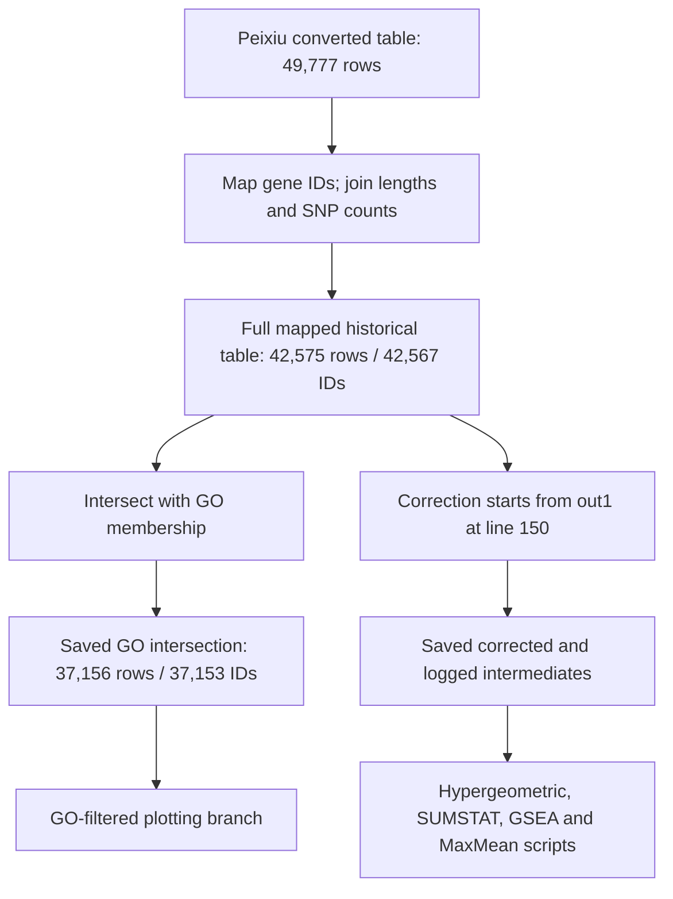

# Historical data flow and the 42,576 count — 18 October 2026

**The supplied GO file does not contain 42,576 unique genes.** Its unique membership is 44,964. Intersections with the primary short-, middle-, and long-term CT lists do not produce 42,576 either. Replaying the original external-ID mapping produces 42,576 records before excluding one empty target, then 42,575 retained records and 42,567 distinct gene IDs. The saved files also have 42,576 physical lines including a header. These identify two concrete count interpretations, not proof of which one supplied the published number.

**Historical transformations do exist.** The earlier warning about using raw column 5 concerned the new WITHOUTINF reanalysis configurations; it did not establish that the original research lacked fold-change, exponential, or FOSCO transformations. This follow-up distinguishes the historical branches and identifies the data actually read by the original scripts.

All analyses in this report read original files without running the old analysis scripts or modifying their outputs. Long-term CT membership is included only to test the author's count hypothesis; it is not added to the short/middle analysis workflow.

## 1. Testing the proposed definitions of 42,576

Gene-set comparisons normalize chromosome-associated `g/G` spelling, remove empty cells, and count each ID once. This normalization is not genome-version conversion. Literal and normalized GO membership counts are both 44,964.

| Set definition | Unique genes |
|---|---:|
| All member genes in `GO_terms_4899.txt` | 44,964 |
| Primary SHORT list | 44 |
| Primary MIDDLE list | 143 |
| Primary LONG list | 45 |
| Union of SHORT, MIDDLE, and LONG lists | 175 |
| GO membership intersected with SHORT | 43 |
| GO membership intersected with MIDDLE | 143 |
| GO membership intersected with LONG | 44 |
| GO membership intersected with the three-phase CT union | 173 |
| GO membership united with the three-phase CT union | 44,966 |
| All member genes of any GO term containing any of those CT genes, before size filtering | 43,633 |
| Same pathway-member union, using historical size bounds 5–1,499 | 29,531 |

These last two rows also test an alternative interpretation: selecting CT-containing pathways first, then taking every member of those pathways. Neither interpretation produces 42,576.

The two primary CT genes outside the supplied GO annotation are `Glyma.11G180700` (short) and `Glyma.04G232600` (long). The middle primary list is completely represented in GO. Full phase combinations and external intersections are recorded in [universe_42576_evidence.json](universe_42576_evidence.json).

## 2. Exact replay of the mapping and the intermediate 42,576 count

The original mapping algorithm in `#外部資料匯入與校正繪圖.txt:41–59` was independently replayed against all 49,777 Peixiu source records:

| Step | Count |
|---|---:|
| Source records | 49,777 |
| No matching correspondence row | 6,018 excluded |
| More than one matching correspondence row | 1,183 excluded |
| Remaining after those two exclusions | **42,576** |
| Exactly one correspondence row, but an empty target ID | 1 excluded |
| Final retained records | **42,575** |
| Distinct retained target IDs | **42,567** |

The single empty-target case is source gene `Glyma07g09360`, correspondence-file row 15,697. Every final target ID matches `gene_p_len.txt` in identical order and literal spelling; a separate replay also verifies the corresponding source p-value columns exactly. This establishes the saved source-to-mapped-data relationship.

Thus `49,777 - 7,201 = 42,576` describes an intermediate stage. The complete mapping also removes the empty target, giving `49,777 - 7,202 = 42,575` records. Counting those records is still different from counting their unique genes.

For the historical `gene_p_len.txt`, `Yamasaki_Go校正後1213_G_log10.txt`, and several related files:

```text
42,576 physical lines
  = 1 header + 42,575 gene records
  = 1 header + 42,567 distinct IDs + 8 extra duplicate records
```

A scan of 496 original `.txt` files under `研究法` found 15 files matching 42,576 as their physical-line count; all 15 have the same 42,575-record / 42,567-ID distinction. They are related artifacts, not 15 independent confirmations of the reported biological universe.

The repeated IDs are `Glyma.13G198100`, `Glyma.13G307500`, `Glyma.14G087700`, `Glyma.15G012400`, `Glyma.15G173500`, `Glyma.15G187700`, `Glyma.17G191500`, and `Glyma.18G274000`. Each occurs twice. Earlier score checks found conflicting values within these duplicates.

**Inference boundary:** both the pre-empty-target mapping stage and the header-inclusive file count reproduce 42,576. There is no recovered manuscript-generation command identifying which interpretation produced the published number. Accordingly, the reported value must not be silently replaced by 42,567 or treated as a verified unique-gene count.

## 3. The GO intersection exists, but the script later returns to the full input

The original `研究法/大豆基因/程式/#外部資料匯入與校正繪圖.txt` contains two distinct branches:

1. Lines 3–17 read the converted Peixiu external table, gene-version correspondence, gene lengths, and SNP records.
2. Lines 39–58 map old gene IDs and take external columns 5 and 8 as `p_1` and `p_24`; lines 63–75 prepare and write `gene_p_len.txt`.
3. Lines 79–92 load GO membership, retain mapped external rows whose IDs occur in GO, and write `gene_p_len_go_yamasaki.txt`.
4. Line 104 uses that GO-filtered object for a plotting branch.
5. **Line 150 resets `p_middle` from `out1`, the full mapped input.** Lines 163–170 fit/apply a power correction, and lines 173–174 write `Yamasaki_Go校正後1213.txt`.

The saved GO intersection has **37,156 gene rows and 37,153 unique IDs**. Its ID set exactly equals GO intersected with the full historical external ID set. The full set has 5,414 unique IDs outside GO. Thus a filename containing `Go` does not establish that a file contains only GO-annotated genes.

The actual hypergeometric population definition is explicit at `程式/超幾何.txt:63`: `L=length(unique(setdiff(as.character(as.matrix(all_genes_score[,1])), '')))`. Since `all_genes_score` is the loaded `_G_log10` file, that expression yields **42,567** on the saved input. It does not calculate the GO union or a union of phase-specific CT genes. The nearby commented alternative and stale count comment should not be mistaken for the active expression.



The final corrected-to-logged edges in this diagram summarize saved artifacts and consumers. Their full generating code has not been recovered in the 11-script folder; they are not a claim that the folder runs as a complete sequential pipeline. A complete input/output inventory is provided separately.

## 4. Exponential, power, and logarithmic steps are different operations

The converted source is `研究法/大豆基因/數據/外部資料匯入/耐寒資料庫0 1 24hr(轉換後)培修版.txt`. It has 49,777 data rows and separate logFC, p-value, FDR, and FC columns.

### Cached FC columns

For both phases, all 49,777 cached FC values are consistent with:

```text
FC = 10 ^ logFC
```

This comparison allows half the last printed digit in both stored columns and propagates the logFC rounding through the exponential. A fixed absolute/relative tolerance of `1e-8` gives 49,543 short and 49,292 middle matches; the remaining differences fit the file's printed precision. The complete columns do not follow `exp(logFC)` or `2^logFC`.

Example, `Glyma0002s50`, short phase:

```text
logFC column:                         -0.066659471
cached FC column:                     0.857710110
original treatment/control ratio:     0.972619788
separate p-value column:              0.591887937
```

These are distinct measurements/transformations. Identifying the cached base-10 relationship does not establish the intended base of the upstream differential-expression logFC, or prove that this is the transformation used by each enrichment method. The original treatment/control FC branch is the one matched to WITHOUTINF column 5 in the preceding audit.

### FOSCO power correction

The import script explicitly computes:

```text
corrected = 1 - (1 - input_value) ^ (SNP_count ^ lambda)
```

It searches lambda from 0.01 through 1.00 and minimizes absolute Spearman correlation with SNP count in this script. The shown block changes column 2, the short phase, despite naming the object `p_middle`. Another upstream script has a middle-phase block and a different correlation objective.

**Saved-result replay now confirms both phase transformations:** excluding the one original zero-SNP row, all 42,574 rows reproduce `Yamasaki_Go校正後1213.txt` using lambda **0.01 short / 0.47 middle**, with maximum absolute differences `6.11e-16 / 5.55e-16`. Searching the 0.01–1.00 grid against SNP Spearman correlation on those rows selects the same lambdas. In the middle phase, using SNP Pearson correlation instead selects 0.27 and using gene-length Spearman selects 1.00, distinguishing those exploratory alternatives from the saved result. This recovers the transformation embodied in the saved artifact, although the supplied script does not itself show the complete two-phase execution sequence.

Evidence: [fosco_saved_artifact_check.json](fosco_saved_artifact_check.json). The zero-SNP exception is `Glyma.14G129500`; its stored SNP count changes from 0 in the input to 12 in the corrected file and 10 in the `_G` file. Its changed scores and the replacement policy remain to be explained. The exact source and line trace, including all exceptional values, is in [original_script_transform_trace.txt](original_script_transform_trace.txt).

**Follow-up, 20 October 2026:** the new implementation introduced nonzero group means with a global nonzero fallback. Both languages now apply that rule, replacing this remaining zero by 11. The [rerun comparison](SNP_IMPUTATION_VALIDATION_2026-10-20.md) records unchanged fitted lambdas and separates the effect of 12 versus 11 from the unexplained historical short score. This is a new documented rule, not a recovered explanation for the old value 12.

Crucially, the import script takes columns **5 and 8**, whose source headers identify p-values. The cached exponential FC columns are **10 and 11**. The presence of transformed FC in a file does not mean those columns are consumed by this correction block.

### Logged scores and column 6

The statistical scripts consume saved `_G_log10` score files. Plotting code contains explicit `-log10` transformations; `_loge` variants also exist. Matching the 42,574 rows with unchanged gene/length/SNP keys to the high-precision corrected file, rather than its rounded `_G` copy, reproduces all finite scores in those rows by `-log10`: 42,574 short and 42,573 middle values within `5e-8`. The separately inspected changed-SNP gene also has two `_G_log10` scores agreeing with its full-precision corrected values, bringing the total numerical confirmation to 85,149 finite phase values. This resolves most discrepancies from the earlier comparison against rounded probabilities.

One additional middle-phase exception remains: `Glyma.04G222100` has saved corrected value zero, while `_G_log10` stores the finite score `15.47747` and `_loge` stores `#NUM!`. Its zero-handling rule has not been recovered. The precision loss in the rounded `_G` file must not be mistaken for thousands of independent transformation errors. Full comparisons are in [saved_transform_lineage.json](saved_transform_lineage.json).

WITHOUTINF column 6 remains a separate unresolved branch. Its historical `Pvalue` label and values above one do not identify a valid raw probability or a confirmed exponential formula. The treatment worksheets in the two source workbooks contain no retained formulas that explain it. This audit does not assign an invented formula to that column.

Numerical checks, source hashes, and workbook formula counts are in [exponential_source_audit_2026-10-18.json](exponential_source_audit_2026-10-18.json).

## 5. What is known about each program's data

All **11 files in the specified `程式` folder** were inventoried, and all 11 match their archived `legacy/` copies byte for byte. The [script dependency inventory](SCRIPT_DATA_DEPENDENCIES_2026-10-18.md) identifies direct file reads and writes with line numbers and records unresolved paths and in-memory objects. Static calls are not evidence that a whole script completed execution.

The legacy statistics predominantly read corrected/logged intermediates. None of these 11 scripts directly imports the named WITHOUTINF files or `CTgenes 含分數` inputs. Several expect earlier session objects such as `answer`, `answer2`, `k1`, and `k2`; there is no `source()` orchestration joining the folder into a standalone workflow. Therefore direct file dependencies are substantially mapped, while the historical execution order and some intermediate-producing steps remain unresolved.

The next reproduction decisions should follow this recovered data flow: choose the historical versus alternative reanalysis input branch explicitly, establish the actual score columns and universe, recover the missing transformations/selection steps, and then compare reruns against the final tables. Repeating a simulation with an unconfirmed branch would not resolve those provenance questions.
